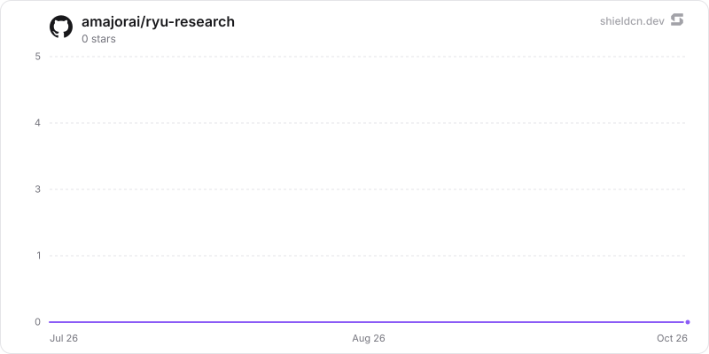

<div align="center">

# research

</div>

Multi-step experiment runs where a frontier model iterates on a task, with its embedded Python engine payload.

> **The public home of `ryu-research`.** Source, builds, and releases live here —
> binaries for every platform are attached to each release.
>
> This tree is generated from the Ryu monorepo, so commits pushed here
> directly are replaced on the next sync. **Pull requests are welcome** —
> open them here and they are ported into the monorepo, then flow back out.
> Ryu as a whole: https://github.com/amajorai/ryu

## Install

**App:** [Install](ryu://apps/com.ryu.research) (opens the Ryu desktop app and asks you to confirm)

**CLI:**

```bash
ryu apps add com.ryu.research
```

**From source:**

```bash
cargo build --release --manifest-path backend/Cargo.toml
```

Prebuilt binaries for every platform are attached to [each release](https://github.com/amajorai/ryu/releases).

## License

Apache-2.0 — see [LICENSE](./LICENSE).

## Parts

- **`sidecar/`** is the dependency-free Python engine. It owns git-versioned
  workspaces and a SQLite database for campaigns, attempts, timestamps, statuses,
  scores, winner decisions, bounded logs, and RLM audit references. `results.tsv`
  remains an imported/exported compatibility format, not the source of truth.
- **`backend/` (`ryu-research`)** is the Rust app sidecar and MCP server. It
  authenticates to the private Python engine with a dedicated token, exposes the
  campaign read model to the companion, and brokers oversized-history analysis to
  the bound `rlm.query` provider without placing that history in the caller's prompt.
- **`ui/`** builds the self-contained Experiments companion. It talks through the
  generic `window.ryu.app.request` bridge; there is no Research-specific Desktop or
  Core API.

## Experiment lifecycle

`research.init_workspace` creates one campaign and returns the same id as both
`workspace_id` and `campaign_id`. `research.next_variant` creates or reuses one
proposal lease for the current history. Each `research.run` consumes that lease,
inserts a durable running attempt before executing, finalizes it even on crash or
timeout, and compares its score using the experiment's minimize/maximize policy. A
strict improvement is kept; every other candidate is reset. The legacy `keep`,
`reset`, and `ledger` tools remain compatible but cannot override the engine's
decision.

`research.run` is a privileged native-execution capability because the experiment command runs
outside Core's JS/WASI sandboxes. Core therefore requires an operator approval for every attempt,
including when global approval mode is **off**, and refuses the call if the approval engine is not
available. Deployments that enable native runs should place the sidecar behind a separate
capability-limited runner.

When serialized history reaches the campaign threshold, `research.next_variant`
automatically submits the canonical snapshot to `rlm.query`. Research accepts only
an answer with a matching `sha256:<64-hex>` input digest, campaign-scoped citations, and a
successful recursive step. The resulting proposal is consumed by exactly one next
attempt. Caller-supplied RLM ids and recommendations cannot satisfy the gate.

## Security boundaries

Core's extension bearer authenticates the public Rust sidecar. A separate owner-only
engine token authenticates Rust/MCP calls to Python and is never exposed to
experiment subprocesses. RLM is a peer app reached through Ryu's capability/MCP
surfaces; Research does not import or dial RLM internals.

## At rest

The Python engine seals campaign content with the `@ryu/research` plugin subkey
(`sidecar/ryu_research/ryu_content_seal.py`, a vendored, vector-tested port of the shared
format: `encb:v1:`, ChaCha20-Poly1305 via `cryptography`, or a pure-Python fallback when
that package is not installed). In `experiments.db` (store `experiments.db`): `campaigns.goal`;
`attempts.hypothesis`, `description` and `logs_tail` (bound to `(campaign_id, ordinal)`,
since attempt ids are AUTOINCREMENT); and `analyses.query`, `response`, `reasoning`,
`error`, `recommendation` and `citations_json` (inserted as empty placeholders and sealed
for their id in the same transaction). Empty strings stay empty. The workspace files
`history.jsonl` (one `encb:v1:` value per campaign, written after the history digest is
computed over the plaintext) and each `results.tsv` row (bound to the campaign only; rows
of one ledger could be reordered without detection) are sealed under store
`workspace-history`; the API, `read_file`, `read_ledger` and the RLM receive opened text.
Campaign names, experiment ids, statuses, scores, digests, commit SHAs, budgets, policies
and timestamps stay plaintext. **Workspace git repositories stay plaintext** (experiment
code, its commits and any ledger rows committed before sealing): experiments execute that
code directly.

Key custody: Core delivers the key to the Rust sidecar (sidecar grant `crypto:seal`), which
takes it out of its environment before its runtime starts and passes it only to the Python
engine; the engine removes it at import, and experiment subprocesses get a scrubbed
environment. The MCP server Core starts receives no key (Core delivers keys to sidecars
only), so an engine it started runs keyless: against a never-sealed store it writes
plaintext (compat), which the next keyed start seals; against a sealed store reads and
writes fail with `503` and a hint to open the Research app. The keyed sidecar replaces a
keyless engine (`POST /admin/shutdown`, then a restart with the key) the next time it needs
the engine; the engine refuses that hand-off (`409`) while the run lock is held or an attempt
is recorded as running, and the sidecar keeps it and retries later. Delivering the key to the
MCP server is a Core change.

History refreshes stay bounded on the pure-Python AEAD: each attempt row is opened once per
history state, writers compute the digest before `BEGIN IMMEDIATE` (recomputing only when
`PRAGMA data_version` shows another connection committed), and startup rebuilds
`history.jsonl` only for campaigns changed since their recorded refresh
(`history_refreshes`) or whose file is missing or still plaintext under a key.

Existing plaintext rows, `history.jsonl` and ledgers are sealed on the first
start with the key (cursor-paginated, compare-and-swap, idempotent; `secure_delete`, WAL
truncate, free pages zero-filled one 64 MiB chunk at a time, and `VACUUM` when disk space
allows; both steps are best-effort, never fail startup and are retried at the next start; this
also runs when the key is first recorded with nothing to reseal). Under compat, text that starts like an envelope
(`encb:v<n>:`) is refused (`400`), and only a recorded key check value marks the store as
sealed. `/health` reports the key state only. A store
sealed under another key, or holding sealed data with no key delivered, refuses writes
(`503`) and is never resealed; a campaign that does not open is skipped at startup. Under an
older Core that delivers no key, a never-sealed store stays plaintext ("waiting for a Ryu
update"). Run standalone, the engine uses `RYU_MASTER_KEY` or generates
`<data dir>/secrets/standalone-root.key` (0600).

## Core-vs-Gateway

Research decides what experiment code runs, so execution remains Core-governed.
Model calls used by the researcher and RLM remain Gateway-governed.

## Star History

<a href="https://github.com/amajorai/ryu-research/stargazers">
  <picture>
    <source media="(prefers-color-scheme: dark)" srcset="./.github/shieldcn/star-chart-dark.svg" />
    
  </picture>
</a>
